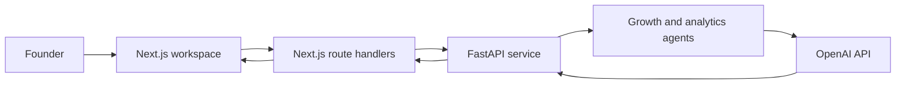

# GrowthCortex

<strong>An AI startup growth copilot for turning a company idea into a structured set of growth questions, experiments, and analytics.</strong>

<a href="https://github.com/kalyan870/growthcortex">Source repository</a> · Next.js 14 · FastAPI · OpenAI

## Project overview

GrowthCortex combines a Next.js workspace with a Python FastAPI service. The UI organizes startup analysis into dashboard, growth, competitor, content, analytics, and settings areas. Next.js route handlers proxy selected requests to the Python API; the Python backend contains the agent modules and analysis endpoints.

## Capabilities in this repository

- Startup analysis and growth planning routes
- Competitor, content, experiment, and analytics workspaces
- Python agent modules behind a FastAPI service
- Next.js API routes for server-side forwarding
- Environment-based API configuration

## Architecture

## Run locally

You need Node.js, Python, and an OpenAI API key.

1. Set `OPENAI_API_KEY` in the backend process environment. Set `BACKEND_URL` and `NEXT_PUBLIC_API_URL` in the Next.js environment (the example values point to `http://localhost:8000`). Keep the key server-side.
2. In one terminal, install `backend/requirements.txt` and start the service with `uvicorn main:app --reload --port 8000` from the `backend` directory.
3. In another terminal, run `npm install` and `npm run dev` from the repository root.
4. Open `http://localhost:3000`.

Keep the OpenAI key on the server. Do not use a real key in a `NEXT_PUBLIC_` variable or commit it.

## Deployment

The Next.js app and FastAPI service are separate deployables. Set `BACKEND_URL` for Next.js server routes and `NEXT_PUBLIC_API_URL` for browser-side requests to a reachable backend URL. The repository includes Vercel configuration, but deploying the UI alone does not deploy the Python service.

## Project structure

- `app/` — Next.js pages and route handlers
- `backend/` — FastAPI app and growth agent modules
- `lib/` — shared frontend API client
- `.env.example` — local configuration names

If the API is unreachable, the frontend API client falls back to sample responses for several views. Check the API connection before treating generated content as a backend result.

## Current scope

This repository is an AI-assisted planning prototype. Generated analysis should be reviewed before using it to make business or investment decisions. It does not include a durable production database or a verified public demo link.

